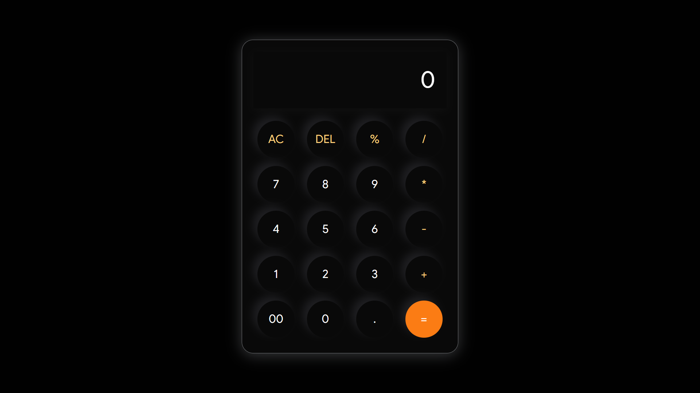

# Calculator

A simple calculator project built using HTML, CSS, and JavaScript.

## Features

- Basic arithmetic operations
- Simple user interface
- Responsive styling

## Technologies Used

- HTML5
- CSS3
- JavaScript

## Preview

## How to Run

1. Clone or download this repository.
2. Open `index.html` in your browser.

## Author

Himanshu Kumar
